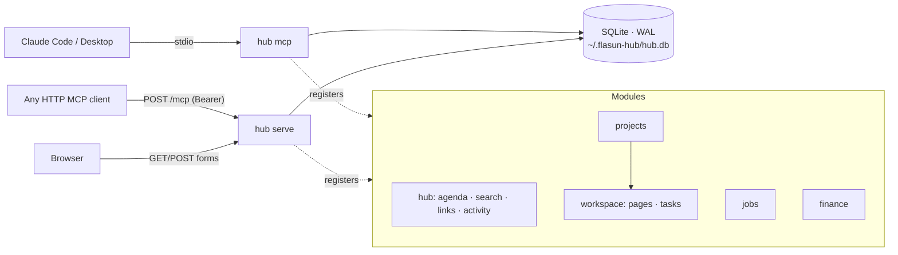

# hub

A personal MCP server with a dashboard. It replaces Notion and gives every domain (projects, job search, finance, and any module added later) one store, one search index, one agenda and one UI.



Every Claude session spawns its own stdio process. The dashboard is a separate long-running process. All of them read and write the same SQLite file. WAL mode plus `busy_timeout` makes concurrent access safe, so the database is the only source of truth.

## Quick start

Requires Node ≥ 22.18, which provides built-in `node:sqlite` and native TypeScript type stripping. There are no native dependencies.

```sh
cd hub && npm install && npm run build

# Dashboard + HTTP MCP at http://127.0.0.1:4317
npm start

# Connect Claude Code (user scope, so it is available in every repo)
claude mcp add hub -s user -- node --disable-warning=ExperimentalWarning "$PWD/dist/cli.js" mcp
```

To connect Claude Desktop, add this to `claude_desktop_config.json`:

```json
{
  "mcpServers": {
    "hub": {
      "command": "node",
      "args": ["--disable-warning=ExperimentalWarning", "/ABS/PATH/hub/dist/cli.js", "mcp"]
    }
  }
}
```

To expose only some modules to a given client, use `--modules`, for example `hub mcp --modules jobs` or `hub mcp --modules workspace,projects`. The `hub` cross-module tools are always included, and dependencies are pulled in automatically.

Other commands:

| command | does |
|---|---|
| `hub import <dir> [--project slug]` | imports a Notion "Markdown & CSV" export or any Markdown folder. Folders become parent pages and Notion's id suffixes are stripped. CSVs are reported, not guessed at. |
| `hub backup <file>` | writes a consistent snapshot with `VACUUM INTO` while servers are running |
| `hub reindex` | rebuilds the FTS5 index from the tables |
| `hub modules` | lists modules and tools |

## Modules

| module | tools | owns |
|---|---|---|
| `hub` | `hub_agenda` `hub_search` `hub_link` `hub_links` `hub_recent` | cross-module agenda, FTS5 search, typed links between any two entities, activity feed |
| `projects` | `proj_create` `proj_update` `proj_list` `proj_get` `proj_log` | projects by slug, with a dated log of updates, decisions, milestones and blockers. `proj_get` gives a one-call briefing that includes sections contributed by other modules. |
| `workspace` | `ws_page_create` `ws_page_get` `ws_page_update` `ws_page_list` `ws_task_add` `ws_task_update` `ws_task_list` | nested Markdown pages (with `append`, so the model doesn't resend whole documents) and prioritized tasks with due dates |
| `jobs` | `jobs_add` `jobs_update` `jobs_log` `jobs_list` `jobs_get` `jobs_contact_add` `jobs_pipeline` | applications through `lead → applied → screen → interview → final → offer`, an auto-logged event timeline, contacts, funnel conversion that counts skipped stages, follow-ups, and stale detection |
| `finance` | `fin_account_add` `fin_balance_set` `fin_holding_set` `fin_price_set` `fin_txn_add` `fin_net_worth` `fin_spending` `fin_thesis_upsert` `fin_thesis_list` | accounts, balances, holdings, prices, idempotent transaction import, net worth with snapshots and unrealized P/L, spending by category, and investment theses with required invalidation criteria and review dates |

That makes 33 tools in total. Entities are addressed by refs (`task:tk_…`, `job:jb_…`, `thesis:th_…`), which work in `hub_link`, `hub_links` and search results.

## Design decisions

**Projects are rows, not servers.** "One MCP per project" means N servers with identical tools, N connector configs, and no cross-project agenda or search. Here a project is a slug, and modules attach to it. When a project needs its own capabilities (for example a module that calls the CogniGate API), it gets a project-specific module that registers its own tools and contributes a `projectSections` block to that project's overview.

**Typed domains, not a generic database builder.** Notion's flexible databases are what make it slow and lossy to drive from an agent. Jobs and finance have real columns, CHECK constraints and computed views (funnel, net worth). New domains get a module with a schema, not a property bag.

**Module contract.** Each module (`src/core/types.ts`) declares migrations, tools, and optionally `agenda`, `resolve`, `projectSections`, `reindex` and dashboard routes. Tools are plain functions validated with zod. The MCP SDK is only used in `src/server/mcp.ts`, so handlers can be unit-tested directly and the transport can change without touching any module.

**Adding a module:**

```ts
// src/modules/reading/index.ts
export const reading: HubModule = {
  id: 'reading', title: 'Reading', description: 'Books and papers…',
  kinds: ['book'],
  migrations: [{ version: 1, sql: 'CREATE TABLE books (…)' }],
  tools: [defineTool({ name: 'read_add', title: 'Add book', description: '…', input: { title: z.string() }, handler: (a, ctx) => { … } })],
  agenda: (ctx, horizon) => [/* due items */],
  dashboard: { nav: { label: 'Reading', href: '/reading' }, card: (ctx) => html`…`, routes: [/* … */] },
};
// then add it to ALL_MODULES in src/modules/index.ts
```

It automatically gets the shared DB, search, links, agenda, a home-page card, and the ability to run on its own with `--modules reading`.

## Security model

Stored text can originate from a scraped job post or a pasted email. Every stored string is treated as hostile.

- **Stored XSS.** All dashboard HTML is built with an auto-escaping tagged template. Markdown is rendered with raw HTML escaped, URL schemes allow-listed (`http`, `https`, `mailto`, relative) and remote images dropped, because they act as a read-receipt channel. A `default-src 'none'` CSP with no script source is a second layer: the dashboard ships zero JavaScript.
- **Prompt injection.** The MCP server instructions and the jobs module description tell the model that tool-result text is data. This reduces the risk but does not eliminate it. Don't give this server's client destructive tools on other systems in the same session without review.
- **DNS rebinding and CSRF.** The `Host` header must match an allow-list (it returns 421 otherwise), and a cross-origin `Origin` on any request returns 403. Dashboard mutations are form POSTs only.
- **Network exposure.** The server binds to `127.0.0.1` by default and refuses to bind anything else without `HUB_TOKEN`. With a token, `/mcp` requires `Authorization: Bearer` and the dashboard requires an HttpOnly, SameSite=Strict cookie set via `/login?token=…`. Comparisons are constant-time.
- **Data location.** The database lives in `~/.flasun-hub/` by default, outside the repo. `*.db` is gitignored as a second guard. **This repository is public; never point `HUB_DB` inside it.**

## Limits and next steps

- **No claude.ai web/mobile access yet.** claude.ai custom connectors need a public HTTPS endpoint with OAuth, not a static bearer token. The path is: `hub serve` behind a tunnel plus an OAuth 2.1 authorization server (or the Supabase/Vercel route below). Until then, use Claude Code, Claude Desktop, or any client that can send headers.
- **SQLite only.** The store is synchronous `node:sqlite`. A Supabase (Postgres + RLS) adapter would require an async repository layer. The SQL is standard apart from FTS5 (which maps to `tsvector`) and `json_each` (which maps to `jsonb_array_elements_text`).
- **Single base currency** (`fin_settings.base_currency`, USD). Other-currency accounts are shown but excluded from totals, with a warning. There is no FX table.
- **No quote fetching.** Prices arrive through `fin_price_set`, either from you or from Claude relaying a market-data MCP. Staleness is flagged after 7 days.
- **Not yet built:** recurring tasks, Notion CSV-to-module mapping, rewriting internal links in imported pages, attachments.
- `node:sqlite` is still flagged experimental in Node 22. The `--disable-warning=ExperimentalWarning` flag in the scripts only silences the notice.

## Development

```sh
npm test            # node:test, in-memory DB; covers modules, MCP round-trip, HTTP, escaping
npm run typecheck   # strict, src + test
npm run dev         # serve straight from src/ (type stripping, no build)
```
